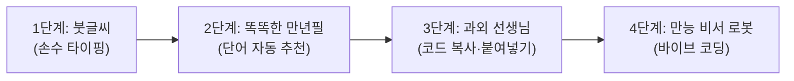

# 바이브 코딩(Vibe Coding) 핵심 요약 발표 자료 (총 10장)

---

## [Slide 01/10] 표지: 상상이 코드가 되는 시대, 바이브 코딩

# 🚀 상상이 코드가 되는 시대: 바이브 코딩(Vibe Coding)
### 프로그래밍 언어를 몰라도 생각과 느낌만으로 만드는 새로운 소프트웨어 혁명

* **발표자:** 시니어 AI 엔지니어
* **핵심 대상:** 코딩 경험이 없는 비전공자, 기획자, 학생 누구나
* **발표 주제:** 바이브 코딩의 개념, 탄생 배경, 작동 원리, 실전 활용법

> 🗣️ **발표 스피치 가이드:**  
> "안녕하세요! 오늘 여러분께 소개할 이야기는 어려운 컴퓨터 언어를 한 줄도 몰라도, 친구와 편하게 이야기하듯 말만 하면 프로그램이 뚝딱 완성되는 **'바이브 코딩'**입니다. 지금 개발의 세계에서 어떤 마법 같은 변화가 일어나는지 딱 10장의 장표로 핵심만 짚어드리겠습니다."

---

## [Slide 02/10] 변화의 본질: 벽돌공에서 영화감독으로

### 🎬 "소프트웨어를 만드는 주인이 바뀌었습니다"

| 비교 항목 | 과거의 전통 코딩 | 지금의 바이브 코딩 |
| :--- | :--- | :--- |
| **사람의 역할** | **벽돌공 (단순 노동)** | **영화감독 (총괄 기획)** |
| **필요한 기술** | 복잡한 컴퓨터 문법 암기, 오타 없는 타이핑 | "무엇을 만들고 싶은지" 명확한 아이디어와 느낌 |
| **소통 방식** | 기계 전용 언어 (C, 파이썬, 자바스크립트 등) | 우리가 매일 쓰는 일상 언어 (자연어 대화) |
| **작업 시간** | 화면 하나 만드는 데 며칠~수주일 소요 | 말 몇 마디로 몇 분~몇 시간 안에 완성 |

> 💡 **핵심 메시지:**  
> 이제 코딩은 '컴퓨터 언어를 손으로 치는 노동'이 아니라, **'내 생각과 감각을 말로 전달하는 지휘'**입니다.

---

## [Slide 03/10] 개념 정의: 만능 요리 로봇에게 주문하듯

### 🍳 "느낌(Vibe)만 말하면 요리가 완성됩니다"

* **바이브 코딩(Vibe Coding)이란?**  
  어려운 프로그래밍 언어 대신, 일상 대화로 **원하는 분위기와 목표(Vibe)**를 말하면 AI가 스스로 코드를 짜고 프로그램을 실행해 주는 개발 방식입니다.

* **만능 요리 로봇 비유:**
  * ❌ **과거 방식:** 칼 잡는 각도, 불 세기, 소금 몇 그램까지 사람이 책 보고 직접 요리
  * ⭕ **바이브 코딩:** 로봇에게 *"오늘 기분이 울적한데, 달콤하고 매콤한 떡볶이 좀 만들어줘!"*라고 느낌만 전달

> 🗣️ **발표 스피치 가이드:**  
> "'바이브(Vibe)'는 영어로 '느낌, 분위기'를 뜻합니다. 디테일한 기술 구현은 똑똑한 AI 조수에게 완전히 맡기고, 사람은 '어떤 느낌의 물건이 필요한지'만 던져주는 것이 바이브 코딩의 본질입니다."

---

## [Slide 04/10] 탄생 배경: 세계 1등 AI 석학의 충격 선언

### 📌 2025년 2월, 안드레이 카파시(Andrej Karpathy)의 고백

* **인물 소개:**  
  * 테슬라 자율주행의 인공지능 두뇌를 설계한 총괄 책임자
  * 챗GPT를 탄생시킨 OpenAI의 핵심 창립 멤버 (세계 최고 실력자)

* **그가 SNS에 남긴 선언:**
  > *"요즘 저는 코드를 쳐다보지도 않습니다.  
  > 대충 보고 AI에게 **'이런 느낌(Vibe)으로 해줘!'** 하고 말로 던집니다.  
  > 에러가 나면 멈춘 화면을 그대로 보여주고 고치게 합니다. 코드가 어떻게 생겼는지는 잊어버렸습니다."*

* **선언의 파급력:**  
  세계 최고 수준의 개발자가 "나도 더 이상 코드를 직접 치지 않는다"고 밝히면서, 전 세계에 바이브 코딩 열풍이 불기 시작했습니다.

---

## [Slide 05/10] 4단계 진화사: 붓글씨에서 만능 로봇까지

### 📈 컴퓨터와 대화하는 도구의 역사

1. **1단계 (붓글씨 시대, ~2020년):** 사람이 명령어 사전을 외워 점 하나까지 직접 입력. 오타 하나에 며칠 밤샘.
2. **2단계 (똑똑한 만년필, 2021년경):** 스마트폰 자동 완성처럼 다음 단어를 살짝 추천해 주는 수준.
3. **3단계 (과외 선생님, 2022~2023년):** 챗GPT가 코드를 써주면 사람이 일일이 복사해서 옮겨 붙이는 심부름 수행.
4. **4단계 (만능 비서 로봇, 2024년 말~현재):** **복사할 필요도 없이, AI가 파일 수정부터 실행, 검증까지 스스로 완결.**

---

## [Slide 06/10] 3대 작동 원리: AI는 어떻게 척척 만들까?

### 🤖 바이브 코딩을 가능하게 하는 AI의 3가지 능력

1. **찰떡같이 알아듣는 귀 (자연어 의도 파악)**  
   * *"배경을 바다 느낌으로 시원하게 해줘"*라고만 말해도, 수많은 디자인을 학습한 AI가 푸른색 톤과 널찍한 여백을 스스로 적용합니다.
2. **스스로 만들고 고치는 손발 (자율 실행과 자가 교정)**  
   * 코드를 작성한 뒤 자기가 직접 실행해 봅니다. 빨간 불(에러)이 뜨면 스스로 원인을 찾아 몰래 고쳐서 완제품을 내놓습니다.
3. **프로젝트를 잊지 않는 기억 상자 (작업 맥락 유지)**  
   * 앞서 나눈 대화, 폴더 안의 파일들, 전체적인 디자인 규칙을 머릿속에 기억하면서 작업을 이어갑니다.

---

## [Slide 07/10] 3대 혁신 강점: 왜 전 세계가 열광하는가?

### 🚀 누구나 창작자가 되는 세상

* **1. 제작 시간의 압도적 단축 (몇 주 ➔ 몇 시간)**  
  * 전문 개발자 5명이 한 달 동안 만들던 시제품을 혼자서 반나절 만에 완성
* **2. 진입 장벽의 완전한 소멸 (누구나 크리에이터)**  
  * 학생, 직장인, 디자이너, 소상공인 누구나 자신에게 필요한 맞춤 앱과 프로그램을 직접 제작
* **3. 실패 비용의 제로(0)화 (초고속 아이디어 실험)**  
  * 좋은 생각이 떠오르면 10분 만에 뚝딱 만들어보고, 시장의 반응이 없으면 부담 없이 다음 아이디어로 전환

---

## [Slide 08/10] 2대 함정과 주의점: 시니어 엔지니어의 경고

### ⚠️ 화려한 마술 뒤에 숨은 2가지 함정 피하기!

1. **'겉만 번지르르한 모래성' 주의 (꼼꼼한 직접 테스트)**  
   * **함정:** 겉모습은 아주 예쁜데, 특정 버튼을 누르면 엉뚱하게 작동하거나 멈출 수 있습니다.
   * **대책:** 완성된 결과물을 사람이 직접 마우스로 구석구석 눌러보고 만져보며 확인해야 합니다.
2. **'도둑을 막는 자물쇠' 챙기기 (보안 및 개인정보 점검)**  
   * **함정:** AI는 문을 멋지게 달아주지만, 문에 자물쇠를 단단히 잠그는 일은 깜빡할 수 있습니다.
   * **대책:** 비밀번호, 결제 정보, 개인정보 같은 민감한 데이터는 배포 전에 사람이 안전한지 점검해야 합니다.

---

## [Slide 09/10] 실전 활용 꿀팁: AI에게 똑똑하게 말하는 3원칙

### 🎯 이렇게 지시하면 결과물의 품질이 2배로 올라갑니다

* **원칙 1. '상황'과 '기분/목적'을 함께 구체적으로 말하기**  
  * ❌ *"버튼 하나 만들어줘"*
  * ⭕ *"초등학생도 누르기 쉽게 크고 노란색인 '시작하기' 버튼을 화면 가운데에 놔줘"*
* **원칙 2. 집 전체를 한 번에 뜯어고치지 말기 (한 번에 하나씩)**  
  * 한꺼번에 많은 걸 요구하면 AI도 실수합니다. "벽지 먼저", 그 다음 "바닥 장판" 순서로 하나씩 수정하세요.
* **원칙 3. 요리 간을 보듯 끊임없이 피드백 주기**  
  * AI가 만든 것을 써보고 *"글씨가 살짝 작아서 안 보여, 1.5배만 키워줘"*라고 친구와 수다 떨듯 고쳐나가세요.

---

## [Slide 10/10] 결론: 상상력이 최고의 기술이 된 시대

### 🌈 코딩의 주인이 바뀐 미래를 준비하세요

* **어제의 소프트웨어:**  
  * 컴퓨터 언어 문법을 달달 외운 **'기술자'**가 대우받던 시대
* **오늘과 내일의 소프트웨어:**  
  * 세상에 어떤 가치와 즐거움을 줄지 고민하는 **'상상가와 기획자'**가 주인공인 시대

> 🗣️ **마무리 스피치:**  
> "이제 기술이라는 벽은 완전히 허물어졌습니다. 가장 중요한 준비물은 여러분의 번뜩이는 아이디어와 호기심뿐입니다. 지금 바로 AI에게 말을 걸어 나만의 첫 프로그램을 만들어보세요. 감사합니다! (질문과 답변 Q&A)"
